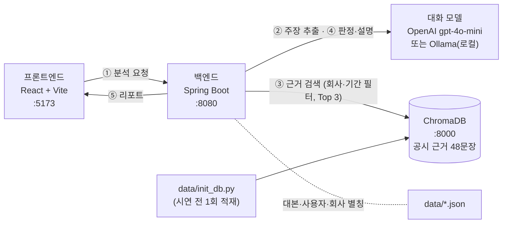

# WON ATTACK

> 핀플루언서를 향한 팩트 폭격 — 유튜브 속 투자 주장을 **공식 공시로 검증**하고, **내 계좌 기준의 위험**까지 알려 주는 MTS 리포트
> 우리WON 청년 IT 아카데미 · AX 해커톤 · B반 4팀

## 문제

유튜브·SNS 투자 콘텐츠(핀플루언서)를 보고 종목을 사는 투자자가 늘고 있지만, 영상 속 수치가 맞는지 확인하려면
DART 공시를 직접 찾아 회사·기간·기준까지 맞춰 비교해야 합니다. 한 영상 안에 사실·과장·예측이 섞여 있고,
같은 "비중 늘리세요"가 보유 비중 80%인 사람과 10%인 사람에게 똑같이 전달됩니다.

## 해결

쇼츠에서 **공유 버튼 한 번**으로 WON MTS를 고르면, 매수 버튼을 누르기 전에 리포트 한 장을 받습니다.

| 불편 | 기능 |
|---|---|
| 확인이 어렵다 | **공식 근거와 원문 링크** — DART 공시·회사 IR만 근거로 쓰고 원문 링크를 붙입니다 |
| 사실과 과장이 섞여 있다 | **주장별 판정** — 근거 확인 · 불일치 · 근거 부족 · 예측 |
| 영상은 나를 모른다 | **내 계좌 기준 위험 설명** — 판정은 모두에게 같게, 설명은 보유 비중·투자 성향에 맞게 |

추천이 아니라 검증입니다. 매수·매도를 지시하거나 수익을 보장하지 않으며, 근거가 없으면 지어내지 않고 "근거 부족"으로 답합니다.

## 아키텍처

배포 없이 **노트북 한 대에서 로컬로 실행**합니다. Docker·Supabase는 쓰지 않습니다.



| 구성 | 주소 | 역할 |
|---|---|---|
| 프론트엔드 (React + Vite) | `http://localhost:5173` | 유튜브·쇼츠 화면 → 공유 시트 → WON MTS 리포트. `/api` 요청을 백엔드로 프록시 |
| 백엔드 (Spring Boot) | `http://localhost:8080` | `POST /api/analyze` — 주장 추출 → 근거 검색 → 판정 → 개인화 |
| ChromaDB (로컬 서버) | `http://localhost:8000` | 공시 근거 문장 임베딩 저장 · 유사도 검색. 데이터는 `data/chroma_db/` (커밋 금지) |
| 대화 모델 | OpenAI 또는 `http://localhost:11434` | `LLM_PROVIDER=openai`(기본, `gpt-4o-mini`) 또는 `ollama`(로컬 LLM) |
| 임베딩 모델 | OpenAI | `text-embedding-3-small` — 적재와 검색에 반드시 같은 모델 |

**분석 흐름**

1. 프론트가 유튜브 URL과 사용자 ID로 분석을 요청합니다.
2. 백엔드가 영상 대본을 찾습니다. `data/youtube_transcripts.json`(실제 영상 전사)을 먼저 보고, 없으면 `data/transcripts.json`(시연 대본)을 봅니다. 대화 모델로 검증할 주장을 뽑고, 회사·기간(예: "이번 3분기" → `2026-Q3`)까지 정리합니다.
3. 주장을 임베딩해 ChromaDB에서 **회사 → 기간 필터**를 건 뒤 비슷한 공시 근거 Top 3를 찾습니다. 공시 근거는 시연 전에 `data/init_db.py`로 미리 적재해 둡니다.
4. 대화 모델이 주장과 근거를 대조해 판정하고(유사도는 판정이 아닙니다), `data/users.json`의 보유 비중·투자 성향에 맞춰 위험 설명을 만듭니다.
5. 주장별 판정 · 근거 출처 · 개인화 설명을 JSON으로 돌려주고, 프론트가 MTS 리포트 카드로 보여 줍니다.

공통 판정은 사용자와 무관하게 같고, 개인화 설명만 사용자마다 달라집니다.

## 기술 스택

| 영역 | 기술 |
|---|---|
| 프론트엔드 | React 18 · Vite · TypeScript |
| 백엔드 | Java 21 · Spring Boot 3.5.7 · Gradle |
| 대화 모델 | OpenAI `gpt-4o-mini`(`OPENAI_CHAT_MODEL`) / Ollama 로컬 LLM(`OLLAMA_CHAT_MODEL`) — `LLM_PROVIDER`로 전환 |
| 임베딩 | OpenAI `text-embedding-3-small` (1536차원) |
| 벡터 DB | ChromaDB 로컬 서버 · 컬렉션 `disclosures` · cosine |
| 데이터 | 5개 기업(삼성전자·SK하이닉스·현대자동차·네이버·카카오) DART 공시·회사 IR 기반 근거 문장 48개 |
| 시연 영상 | Remotion으로 만든 가상 투자 영상 3편 (`video/`) |
| 실행 환경 | 로컬(Windows · macOS), 배포 없음 · Docker 미사용 |

## 폴더 구조

```
won-attack/
├── README.md
├── .env.example              # 복사해서 .env 생성 (커밋 금지)
├── start-demo.bat / .sh      # 시연 환경 한 번에 실행
├── stop-demo.bat / .sh       # 시연 환경 한 번에 종료
├── pipeline.py               # 실제 YouTube 영상 음성 → Whisper → 구조화 JSON
├── video_inputs.json         # 전사할 영상 URL
├── requirements-transcription.txt
├── tests/test_youtube_pipeline.py
├── docs/
│   ├── api/                  # 프론트·백엔드 공통 API 계약 (요청·응답·오류 예시)
│   └── youtube-pipeline.md   # 영상 전사 안내
├── frontend/                 # React + Vite (유튜브·쇼츠·공유 시트·WON MTS 화면)
├── backend/
│   └── won-check-backend/    # Spring Boot 서버 (gradlew는 여기에 있음)
├── data/                     # 시연 데이터 · 벡터 DB
│   ├── companies.json        # 기업 5곳 · DART 고유번호 · 회사명 별칭
│   ├── disclosures.json      # 근거 문장 48개 + 메타데이터 (→ ChromaDB)
│   ├── financial_facts.json  # 분기별 매출·영업이익 (데이터 검수용)
│   ├── transcripts.json      # 시연 영상 3편의 대본
│   ├── youtube_transcripts.json # 실제 영상 전사 결과 (pipeline.py로 생성)
│   ├── users.json            # 가상 사용자 5명
│   ├── expected_results.json # 리허설용 기대 판정 (서버에 하드코딩 금지)
│   ├── scripts/              # 시연 영상 대본
│   ├── raw/dart/             # 근거로 쓴 DART 공시 원문
│   ├── tools/fetch_dart.py   # OpenDART 수집
│   ├── build_data.py         # 위 JSON 재생성
│   ├── init_db.py            # 임베딩 → ChromaDB 적재
│   └── check_db.py           # 시연 주장의 근거를 찾는지 점검 (7/7)
└── video/                    # Remotion 시연 영상 제작 · 결과물은 video/out/
```

## 실행 방법 (로컬)

필요한 것: Python 3.10+, Java 21, Node.js 18+, OpenAI API 키 (Ollama를 쓸 때도 임베딩에 필요)

### 한 번에 실행 (권장)

루트 `.env`에 `OPENAI_API_KEY`를 넣은 뒤 실행 파일 하나로 시연 환경 전체를 띄웁니다.

```bash
copy .env.example .env    # macOS: cp .env.example .env → OPENAI_API_KEY 입력
```

| 파일 | 쓰는 법 |
|---|---|
| `start-demo.bat` | Windows. 더블클릭 → ChromaDB · 백엔드 · 프론트 창 3개가 열림. 근거 DB 다시 적재: `start-demo.bat reset` |
| `stop-demo.bat` | Windows. 더블클릭 → 위 창 3개를 한 번에 종료 |
| `start-demo.sh` | macOS. `./start-demo.sh` (다시 적재: `./start-demo.sh reset`) → 한 터미널에서 실행, `Ctrl+C`로 모두 종료, 로그는 `logs/` |
| `stop-demo.sh` | macOS. 터미널을 그냥 닫았거나 포트가 남아 있을 때 `./stop-demo.sh` → 8000·8080·5173 포트 프로세스 종료 |

실행 파일은 `.env`의 값을 그대로 백엔드에 넘깁니다. 대화 모델은 `.env`에서 고릅니다.

| 쓰고 싶은 모델 | `.env` 설정 |
|---|---|
| OpenAI (시연 기본) | `LLM_PROVIDER=openai` |
| Ollama (로컬 LLM) | `LLM_PROVIDER=ollama`, `OLLAMA_CHAT_MODEL=<설치한 모델 이름>` — Ollama를 먼저 켜 두세요 |

임베딩은 `EMBEDDING_PROVIDER=openai`로 둡니다. 근거 DB 점검(`check_db.py`)이 OpenAI 임베딩 기준이기 때문입니다.

실행 순서

1. `.env`의 키를 읽고 Python · Node.js · Java 설치 여부를 확인합니다. chromadb·openai가 없으면 `data/requirements.txt`로 설치합니다.
2. 근거 DB(`data/chroma_db`)가 없거나 `reset`을 붙였을 때만 `init_db.py`로 적재합니다.
3. ChromaDB 서버를 켭니다 (`:8000`).
4. `check_db.py --server`로 근거 검색을 점검합니다. **7/7이 아니면 여기서 멈춥니다** — 데이터 문제를 백엔드보다 먼저 잡기 위해서입니다.
5. 백엔드를 켭니다 (`:8080`, `WONCHECK_MODE=live`, 데이터 경로·ChromaDB 주소 자동 지정). 백엔드 폴더는 `backend/won-check-backend/`를 자동으로 찾습니다.
6. 프론트를 켭니다 (`:5173`, `VITE_USE_MOCK=false`). `node_modules`가 없으면 `npm install`부터 합니다.
7. 백엔드가 뜨면 브라우저로 `http://localhost:5173`을 엽니다.

문제가 생기면

| 증상 | 확인할 것 |
|---|---|
| "백엔드 코드(gradlew)가 없습니다" | `git pull`로 최신 main을 받았는지. macOS에서 실행 권한이 없으면 `chmod +x backend/won-check-backend/gradlew` |
| 4단계 점검 실패 | 데이터 쪽 문제 → `reset`을 붙여 다시 적재 |
| 화면에서 판정이 이상함 | 점검(7/7)은 통과했으니 백엔드 쪽(회사명 추출·검색 필터·대화 모델 설정)을 확인 |
| Ollama로 바꿨더니 분석 실패 | Ollama가 켜져 있는지, `OLLAMA_CHAT_MODEL`이 비어 있지 않은지 |
| 포트가 이미 사용 중 | `stop-demo.bat`(macOS `./stop-demo.sh`)으로 이전 실행을 끄고 다시 실행 |

### 직접 실행할 때

```bash
# 0) 환경 변수
copy .env.example .env                         # macOS: cp .env.example .env → OPENAI_API_KEY 입력
pip install -r data/requirements.txt

# 1) 벡터 DB 적재 (시연 전 1회, 데이터가 바뀔 때만 다시)
python data/init_db.py --reset                 # data/chroma_db 에 근거 48문장 적재
python data/check_db.py                        # 근거 검색 점검 → 7/7이면 정상

# 2) ChromaDB 서버 켜기 (터미널 1, 켜 둔 채로)
chroma run --path data/chroma_db --port 8000

# 3) 백엔드 (터미널 2)
cd backend/won-check-backend
gradlew.bat bootRun                            # macOS: ./gradlew bootRun → http://localhost:8080

# 4) 프론트엔드 (터미널 3)
cd frontend && npm install && npm run dev      # http://localhost:5173
```

- 1)은 ChromaDB 서버가 **꺼진 상태**에서 실행합니다. 서버가 켜져 있으면 `python data/init_db.py --server --reset`로 서버에 바로 적재하고 `python data/check_db.py --server`로 점검합니다.
- 백엔드는 **루트 `.env`를 읽지 않고**, 실행 폴더(`backend/won-check-backend/`)의 `.env`만 읽습니다. 그 폴더의 `.env.example`을 복사해 쓰거나, 터미널·IntelliJ 실행 설정에 아래 값을 넣으세요.
  - `OPENAI_API_KEY`, `WONCHECK_MODE=live`(기본 `mock`은 판정이 전부 근거 부족), `WONCHECK_DATA_PATH=../../data`
  - `PORT=8080` — 백엔드 폴더의 `.env.example`은 `8081`이라, 프론트 프록시(8080)와 맞추려면 바꿔야 합니다.
  - 자세한 내용은 [backend/README.md](backend/README.md).
- 프론트는 기본이 목업 응답입니다. 실제 백엔드를 쓰려면 `frontend/.env`에 `VITE_USE_MOCK=false`.

## 화면 구성

| 화면 | 내용 |
|---|---|
| 데스크톱 안내 패널 | 휴대폰 화면 왼쪽. 시연 계정 5명 중 선택, 프로필(투자 성향·보유 비중) 미리보기 |
| 유튜브 · 쇼츠 | 시연 영상 3편 재생(`video/out/`의 MP4) → 공유 버튼 → 공유 시트에서 WON MTS 선택 |
| 링크로 분석 | 실제 YouTube 링크를 붙여 넣어 분석 (`48WVf1ijerc` SBS 뉴스 영상) |
| WON MTS 리포트 | 분석 단계 로딩 → 주장별 판정 카드 · DART 원문 링크 · 내 계좌 기준 설명 |
| MTS 메뉴 | 종목 상세, 저장한 리포트 보관함(브라우저에만 저장), 하단 탭 |

결과 화면에서 계정을 바꾸면 같은 영상을 다시 분석합니다. 계정은 URL의 `?demo_user=demo_user_01`로도 지정할 수 있습니다.

## 실제 YouTube 영상 전사

루트 `.env`의 `OPENAI_API_KEY`를 사용합니다. 기존 `data/transcripts.json`은 보존하고, 실제 영상 결과는 별도 `data/youtube_transcripts.json`에 저장합니다. 백엔드는 이 파일을 먼저 읽으므로, 전사한 영상은 바로 분석할 수 있습니다.

```bash
python -m pip install -r requirements-transcription.txt
python pipeline.py
python -m unittest discover -s tests -p 'test_youtube_pipeline.py' -v
```

입력은 `video_inputs.json`이며 `48WVf1ijerc`가 등록되어 있습니다. 결과 파일이 이미 있으면 덮어쓰지 않고 중단합니다. 재실행은 `python pipeline.py --output data/youtube_transcripts_02.json`처럼 새 파일명을 지정하세요. 다운로드 음성과 API 중간 자료는 Git에서 제외한 `runs/`에 보관합니다. `caption`은 화면 OCR이 아닌 음성 요약입니다.

설치·처리 방식·검증 범위는 [영상 전사 안내](docs/youtube-pipeline.md)를 참고하세요.

## API

`POST /api/analyze` — 동기식 JSON 응답. 형식은 `docs/api/`의 예시 파일이 기준입니다.

| 항목 | 값 |
|---|---|
| 요청 | `{ "video_url": "...", "user_id": "demo_user_01" }` |
| `claim_type` | `FINANCIAL` · `DISCLOSURE` · `PREDICTION` |
| `status` | `SUPPORTED` · `CONTRADICTED` · `INSUFFICIENT_EVIDENCE` · `PREDICTION` |
| 오류 | 400 `INVALID_VIDEO_URL` · 404 `VIDEO_NOT_SUPPORTED` · 404 `USER_NOT_FOUND` · 500 `ANALYSIS_FAILED` |

근거가 없으면 `sources: []`를 반환하고 근거를 만들어내지 않습니다.
`analyze_response.json`의 개인화 문구는 형식 예시이며 실제 결과는 대화 모델이 생성합니다.
백엔드의 적재 API(`POST /api/admin/ingest`)는 기본으로 꺼져 있습니다. 적재는 `data/init_db.py`로 합니다.

## 시연 시나리오

| 시나리오 | 영상 | 사용자 | 보여줄 것 |
|---|---|---|---|
| S1 신규 투자 검토 | `WCdemoS1V01` 삼성전자 | `demo_user_03` 이도윤 · 위험중립형 | 근거 확인 · 불일치 · 예측 |
| S2 추가 매수 검토 (메인) | `WCdemoS2V02` SK하이닉스 | `demo_user_01` 박서연 · 공격투자형 / `demo_user_02` 김도현 · 적극투자형 | "3분기 77조 확정"은 **근거 부족**, 같은 판정 · 다른 위험 설명(반도체 비중 80% vs 10%) |
| S3 보유 점검 | `WCdemoS3V03` 현대자동차 | `demo_user_04` 한지은 · 안정추구형(보유) / `demo_user_05` 정영호 · 안정형(미보유) | 부정 과장 영상: 감소는 맞지만 적자는 아님 |
| 실제 영상 | `48WVf1ijerc` SBS 뉴스 (삼성전자 실적) | 아무 계정 | 실제 영상도 같은 흐름으로 분석 |

네이버·카카오는 사용자 보유 종목과 회사 필터 확인용 근거만 들어 있습니다. 자세한 대본과 기대 판정은 `data/scripts/`, `data/expected_results.json`을 보세요.

## 데이터 출처와 고지

- 근거는 **공식 출처만** 씁니다: DART 공시(금융감독원 전자공시) 또는 회사 공식 뉴스룸·IR 자료. 언론 보도는 쓰지 않습니다.
- 모든 핵심 수치는 DART 잠정실적 공시·정기보고서와 대조했습니다. 출처 URL은 `data/disclosures.json`에 문장별로, DART 원문은 `data/raw/dart/`에 있습니다.
- 삼성전자 2026년 3분기 수치는 **잠정 실적**입니다. 3분기 실적 발표 일정(DART 기업설명회 공시): SK하이닉스 10월 28일 09:00, 현대자동차 10월 29일 14:10, 네이버 11월 12일. 그래서 이 회사들은 2분기까지만 들어 있습니다.
- 시연 영상 3편·채널·사용자는 모두 **시연용 가상 데이터**이며 실제 인물·채널과 무관합니다. 영상 음성은 합성 음성입니다.
- 공유 화면과 계좌 정보는 웹 시뮬레이션이고, 분석(대화 모델·임베딩·벡터 검색)은 실제로 동작합니다.

## 추후 고도화

- **리딩방·수익 보장 위험 신호 탐지:** 영상 속 리딩방 유도, 원금·수익 보장, 미공개 정보 암시 표현을 금융위·금감원 안내를 근거로 표시
- DART OpenAPI 공시 자동 수집과 정정 공시 반영, 실제 영상 자동 전사
- 유튜브 공유 시트 · 우리WON MTS 네이티브 연동, 실제 계좌·투자성향 연동(동의 기반)
- 로컬 LLM(Ollama)으로 고객 정보를 외부로 보내지 않는 구성
- 검증 결과 캐시와 근거 변경 알림

## 기여

브랜치·커밋·PR 규칙은 [CONTRIBUTING.md](CONTRIBUTING.md)를 따릅니다. 커밋 메시지는 `종류(범위): 요약` 형식입니다.
PR을 올리면 CI가 커밋 메시지, `.env`·API 키·`chroma_db` 커밋 여부, 데이터 재생성 일치·벡터 검색 경로를 검사합니다.

## 팀

B반 4팀 — 박소정 · 서현진 · 이채원 · 정영준 · 최윤하
