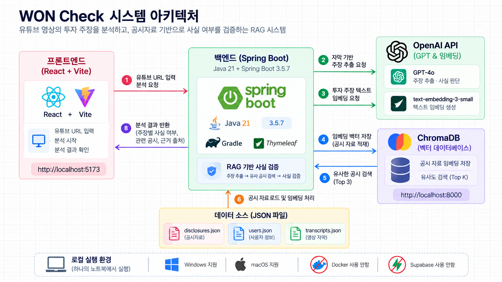

# WON Check

> 유튜브 투자 영상의 주장을 **공식 실적 자료로 검증**하고, **내 포트폴리오 기준의 위험**을 알려주는 서비스
> 우리WON 청년 IT 아카데미 · AX 해커톤 · B반 4팀

## 문제

유튜브·SNS 투자 콘텐츠(핀플루언서)를 보고 종목을 사는 투자자가 늘고 있지만, 영상 속 수치가 맞는지 확인하려면
공시와 실적 자료를 직접 찾아 비교해야 합니다. 사실·의견·전망이 섞여 있고, 같은 추천이 모든 시청자에게 똑같이 전달됩니다.

## 해결

1. 영상의 주장을 **검증 가능한 단위로 추출**하고 사실·전망을 구분합니다.
2. 주장마다 **공식 자료 근거를 검색(RAG)** 해 일치·불일치·근거 부족을 판정하고 출처를 붙입니다.
3. 공통 판정은 그대로 두고, **사용자의 보유 비중·투자 성향**에 맞춘 위험 설명을 더합니다.

추천이 아니라 검증입니다. 매수·매도를 지시하거나 수익을 보장하지 않습니다.

## 아키텍처



배포 없이 **노트북 한 대에서 로컬로 실행**합니다. Docker·Supabase는 쓰지 않습니다.

| 구성 | 주소 | 역할 |
|---|---|---|
| 프론트엔드 (React + Vite) | `http://localhost:5173` | 유튜브 화면 · 공유 모달 · WON MTS 결과 화면. `/api` 요청을 백엔드로 프록시 |
| 백엔드 (Spring Boot) | `http://localhost:8080` | `POST /api/analyze` — 주장 추출 → 근거 검색 → 사실 검증 → 개인화 |
| ChromaDB (로컬 서버) | `http://localhost:8000` | 공시 근거 문장 임베딩 저장 · 유사도 검색(Top 3). 데이터는 `data/chroma_db/` |
| OpenAI API | — | GPT(주장 추출 · 사실 판단 · 개인화 설명), `text-embedding-3-small`(임베딩) |

**분석 흐름** (그림의 번호)

1. 프론트가 유튜브 URL과 사용자 ID로 분석을 요청합니다.
2. 백엔드가 `data/transcripts.json`에서 사전 준비 대본을 찾고, GPT로 검증할 주장 2~3개를 뽑습니다.
3. 주장 문장을 `text-embedding-3-small`로 임베딩합니다.
4. 공시 근거 문장은 **시연 전에 미리** ChromaDB에 적재해 둡니다(`data/init_db.py`, 데이터 담당).
5. 백엔드가 ChromaDB에서 **회사 → 기간 필터**를 건 뒤 비슷한 근거 Top 3를 찾습니다.
6. `data/*.json`(대본 · 사용자 · 회사 별칭 · 재무 수치)은 백엔드가 파일로 직접 읽습니다.
7. GPT가 근거와 수치를 대조해 판정하고, 사용자 포트폴리오·투자 성향에 맞춘 위험 설명을 만듭니다.
8. 주장별 판정 · 근거 출처 · 개인화 설명을 JSON으로 돌려주고 프론트가 카드로 보여줍니다.

공통 판정은 사용자와 무관하게 같고, 개인화 설명만 사용자마다 달라집니다. 유사도는 판정이 아니며, 수치 비교는 `data/financial_facts.json` 기준입니다.

## 기술 스택

| 영역 | 기술 |
|---|---|
| 프론트엔드 | React · Vite · TypeScript |
| 백엔드 | Java 21 · Spring Boot 3.5.7 · Gradle |
| LLM | OpenAI GPT-4o 계열 (`OPENAI_CHAT_MODEL`, 기본값 `gpt-4o-mini`) |
| 임베딩 | OpenAI `text-embedding-3-small` (1536차원) — 적재·검색에 같은 모델 |
| 벡터 DB | ChromaDB 로컬 서버(`chroma run`) · 컬렉션 `disclosures` · cosine |
| 데이터 | 5개 기업(삼성전자·SK하이닉스·현대자동차·네이버·카카오) DART 공시·회사 공식 실적 자료 기반 근거 문장 48개 |
| 실행 환경 | 로컬(Windows · macOS), 배포 없음 · Docker 미사용 |

## 폴더 구조

```
won-check/
├── README.md
├── .env.example          # 복사해서 .env 생성 (커밋 금지)
├── docs/
│   ├── architecture.png
│   └── api/              # 프론트·백엔드 공통 API 계약
├── frontend/             # React + Vite
├── backend/              # Spring Boot
└── data/                 # 데이터 · 벡터 DB
    ├── companies.json        # 기업 5곳 · DART 고유번호 · 회사명 별칭
    ├── disclosures.json      # 근거 문장 48개 + 메타데이터 (→ ChromaDB)
    ├── financial_facts.json  # 분기별 매출·영업이익 (수치 비교용)
    ├── transcripts.json      # video_id별 시연 대본 3개
    ├── users.json            # 가상 사용자 5명
    ├── expected_results.json # 리허설용 기대 판정 (서버에 하드코딩 금지)
    ├── scripts/              # 영상 제작용 대본
    ├── raw/dart/             # 근거로 쓴 DART 공시 원문
    ├── tools/fetch_dart.py   # OpenDART 수집
    ├── build_data.py         # 위 JSON 재생성
    ├── init_db.py            # 임베딩 → ChromaDB 적재 → 검색 점검
    └── requirements.txt      # chromadb · openai
```

## 실행 방법 (로컬)

필요한 것: Python 3.10+, Java 21, Node.js 18+, OpenAI API 키

```bash
# 0) 환경 변수
copy .env.example .env                         # macOS: cp .env.example .env → OPENAI_API_KEY 입력
pip install -r data/requirements.txt

# 1) 벡터 DB 적재 (시연 전 1회, 데이터가 바뀔 때만 다시)
python data/init_db.py --reset --strict        # data/chroma_db 생성 + 근거 Top3 점검(7/7)

# 2) ChromaDB 서버 켜기 (터미널 1, 켜 둔 채로)
chroma run --path data/chroma_db --port 8000

# 3) 백엔드 (터미널 2) — 환경 변수: OPENAI_API_KEY, WONCHECK_MODE=live
cd backend && gradlew.bat bootRun              # macOS: ./gradlew bootRun → http://localhost:8080

# 4) 프론트엔드 (터미널 3)
cd frontend && npm install && npm run dev      # http://localhost:5173
```

- 1)은 ChromaDB 서버가 **꺼진 상태**에서 실행합니다. 서버가 켜져 있으면 `python data/init_db.py --server --reset --strict`로 서버에 바로 적재합니다.
- Spring Boot는 `.env`를 자동으로 읽지 않습니다. 터미널이나 IntelliJ 실행 설정(Environment variables)에 `OPENAI_API_KEY`, `WONCHECK_MODE=live`를 넣으세요. 자세한 내용은 [backend/README.md](backend/README.md).
- 프론트는 기본이 목업 응답입니다. 실제 백엔드를 쓰려면 `frontend/.env`에 `VITE_USE_MOCK=false`.

## API

`POST /api/analyze` — 동기식 JSON 응답. 형식은 `docs/api/`의 예시 파일이 기준입니다.

| 항목 | 값 |
|---|---|
| 요청 | `{ "video_url": "...", "user_id": "demo_user_01" }` |
| `claim_type` | `FINANCIAL` · `DISCLOSURE` · `PREDICTION` |
| `status` | `SUPPORTED` · `CONTRADICTED` · `INSUFFICIENT_EVIDENCE` · `PREDICTION` |
| 오류 | 400 `INVALID_VIDEO_URL` · 404 `VIDEO_NOT_SUPPORTED` · 404 `USER_NOT_FOUND` · 500 `ANALYSIS_FAILED` |

근거가 없으면 `sources: []`를 반환하고 근거를 만들어내지 않습니다.
`analyze_response.json`의 개인화 문구는 형식 예시이며 실제 결과는 LLM이 생성합니다.

## 시연 시나리오

| 시나리오 | 영상 | 사용자 | 보여줄 것 |
|---|---|---|---|
| S1 신규 투자 검토 | `WCdemoS1V01` 삼성전자 | `demo_user_03` 위험중립형 | 확인 · 불일치(매출 200조) · 예측 |
| S2 추가 매수 검토 | `WCdemoS2V02` SK하이닉스 | `demo_user_01` 공격투자형 / `demo_user_02` 적극투자형 | 미발표 실적은 **근거 부족**, 같은 판정 · 다른 개인화(반도체 비중 80% vs 10%) |
| S3 보유 점검 | `WCdemoS3V03` 현대자동차 | `demo_user_04` 안정추구형(보유) / `demo_user_05` 안정형(미보유) | 부정 과장 영상: 감소는 맞지만 적자는 아님 |

영상은 기업별 1개(삼성전자·SK하이닉스·현대자동차)입니다. 네이버·카카오는 사용자 보유 종목과 회사 필터 확인용 근거만 들어 있습니다.

자세한 대본과 기대 판정은 `data/scripts/`, `data/expected_results.json`을 보세요.

## 데이터 출처와 고지

- 근거는 **공식 출처만** 씁니다: DART 공시(금융감독원 전자공시) 또는 회사 공식 뉴스룸·IR 자료. 언론 보도는 쓰지 않습니다.
- 모든 핵심 수치는 DART 잠정실적 공시·정기보고서와 대조했습니다. 출처 URL은 `data/disclosures.json`에 문장별로, DART 원문은 `data/raw/dart/`에 있습니다.
- 삼성전자 2026년 3분기 수치는 **잠정 실적**입니다. 3분기 실적 발표 일정(DART 기업설명회 공시): SK하이닉스 10월 28일 09:00, 현대자동차 10월 29일 14:10, 네이버 11월 12일. 그래서 이 회사들은 2분기까지만 들어 있습니다.
- 시연 영상·채널·사용자는 모두 **시연용 가상 데이터**이며 실제 인물·채널과 무관합니다.
- 공유 화면은 웹 시뮬레이션이고, 분석(LLM·임베딩·벡터 검색)은 실제로 동작합니다.

## 추후 고도화

- **리딩방·수익 보장 위험 신호 탐지:** 영상 속 리딩방 유도, 원금·수익 보장, 미공개 정보 암시 표현을 금융위·금감원 안내를 근거로 표시
- DART OpenAPI 공시 자동 수집과 정정 공시 반영
- 유튜브 공유 시트 · 우리WON MTS 네이티브 연동, 실제 계좌·투자성향 연동(동의 기반)
- 검증 결과 캐시와 근거 변경 알림

## 기여

브랜치·커밋·PR 규칙은 [CONTRIBUTING.md](CONTRIBUTING.md)를 따릅니다. 커밋 메시지는 `종류(범위): 요약` 형식입니다.

## 팀

| 역할 | 담당 |
|---|---|
| 기획 · 발표 |  |
| 프론트엔드 |  |
| 백엔드 |  |
| 데이터 · 벡터 DB |  |
